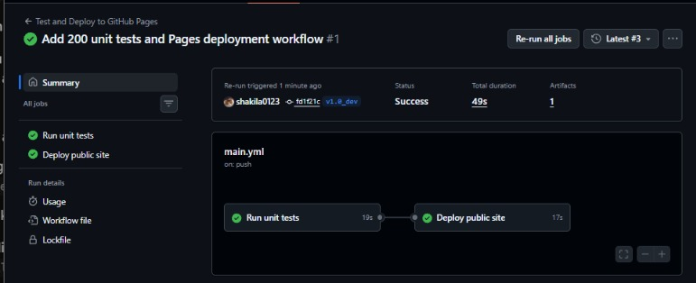
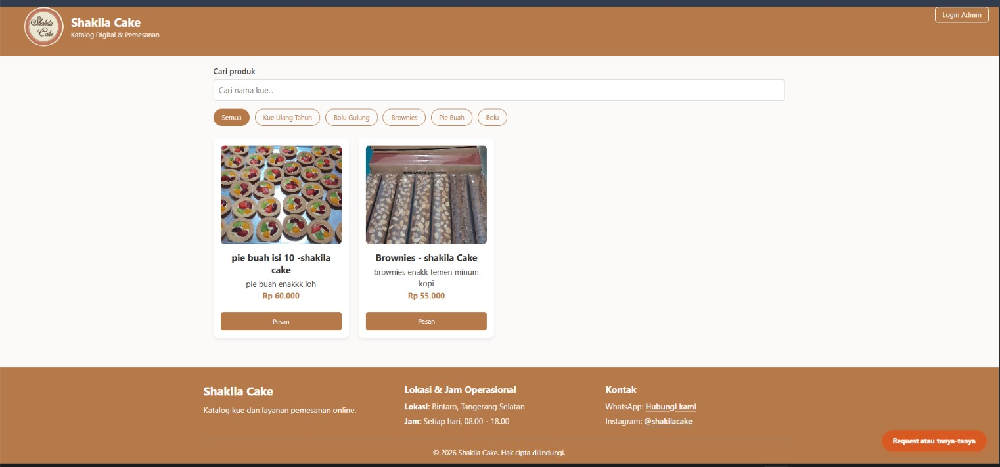
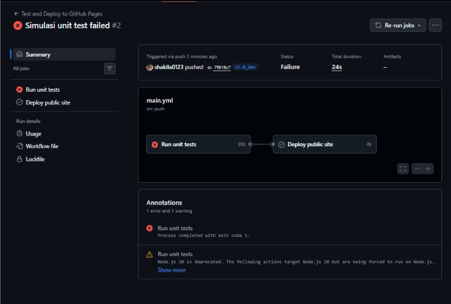
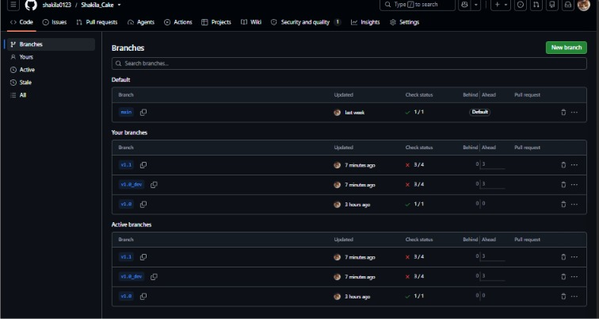

# Bukti Pengerjaan Tugas P11 — Unit Testing, CI/CD, & Branching

* **Nama Proyek:** Shakila Cake (Katalog Digital & Pemesanan)
* **Repository GitHub:** [https://github.com/shakila0123/Shakila_Cake]
* **Live Website (GitHub Pages):** [https://shakila0123.github.io/Shakila_Cake/]
---

## 1. Eksekusi 200 Unit Test & Otomatisasi CI/CD (Lulus / Hijau)

Pengujian otomatis menggunakan Jest sebanyak **200 skenario unit test** (`tests/expanded_scenarios.test.js`) dijalankan melalui pipeline GitHub Actions (`.github/workflows/main.yml`). Seluruh unit test berhasil lulus (*Passed*) sehingga proses deployment otomatis ke GitHub Pages berjalan hingga selesai dengan status **Success**.

---

## 2. Hasil Deployment Website Live (GitHub Pages)

Setelah pipeline CI/CD selesai dieksekusi, website **Shakila Cake** berhasil dipublikasikan secara online melalui GitHub Pages dengan tampilan katalog produk, fitur pencarian, filter kategori, serta struktur footer 3 kolom yang rapi dan responsif.

---

## 3. Simulasi Unit Test Gagal (*Failed*) & Efeknya terhadap Pipeline

Dilakukan simulasi pengujian gagal dengan mengubah sementara salah satu ekspektasi nilai pada skenario pengujian agar sengaja menghasilkan error (*Failed*).

**Efek pada alur CI/CD:**
* Tahap **Run unit tests** berhenti dengan status gagal (`Failure` / `exit code 1`).
* Tahap **Deploy public site** secara otomatis dibatalkan/dilewati (*Skipped*).

Hal ini membuktikan bahwa sistem *Continuous Integration* berhasil mencegah kode yang bermasalah untuk naik ke server produksi (Live).

---

## 4. Pemulihan Tes & Rilis Branch (`v1.0`, `v1.0_dev`, dan `v1.1`)

Nilai pengujian yang sebelumnya diubah untuk simulasi telah dikembalikan ke kondisi semula hingga seluruh **200 unit test** kembali lulus (*Passed*). Selanjutnya dilakukan pembuatan dan sinkronisasi branch rilis versi **`v1.1`** berdasarkan perkembangan dari `v1.0` dan `v1.0_dev` sebagai versi stabil terbaru di repository GitHub.

